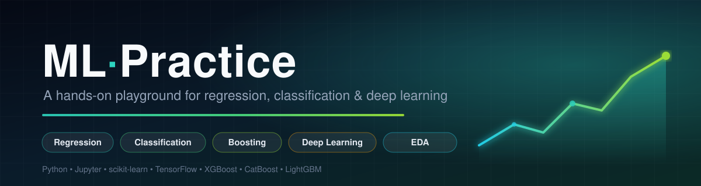
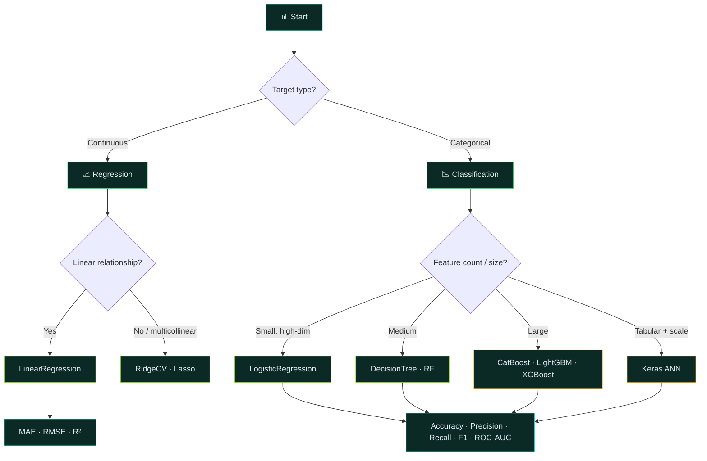

<div align="center">

  

  <br/>

  <p>
    <a href="https://github-readme-stats.vercel.app/api?username=Manohargov&repo=ML-Practice&show_icons=true&include_all_commits=true&theme=tokyonight">
      
    </a>
    <a href="https://github-readme-stats.vercel.app/api/top-langs/?username=Manohargov&layout=compact&theme=tokyonight">
      
    </a>
  </p>

  <p>
    
    
    
    
    
  </p>

  <p>
    
    
    
    
    
    
    
  </p>

  <p>
    
    
    
    
    
    
  </p>

</div>

---

## 📌 Table of Contents

- [🎯 About](#-about)
- [📂 Repository Structure](#-repository-structure)
- [🧪 Projects](#-projects)
  - [🌾 01 · Soybean Yield Prediction](#-01--soybean-yield-prediction-regression)
  - [🏢 02 · HR Employee Attrition](#-02--hr-employee-attrition-classification)
  - [📱 03 · Smartphone Price Tiering](#-03--smartphone-price-tiering-ml--deep-learning)
  - [🏠 04 · Boston Housing Prices](#-04--boston-housing-prices-regression)
- [🔬 Methodology Pipeline](#-methodology-pipeline)
- [📊 Consolidated Results](#-consolidated-results)
- [🔑 Key Findings](#-key-findings)
- [💾 Datasets](#-datasets)
- [🚀 Getting Started](#-getting-started)
- [🧰 Tech Stack](#-tech-stack)
- [🤝 Contributing](#-contributing)
- [📄 License](#-license)
- [🙏 Acknowledgements](#-acknowledgements)

---

## 🎯 About

<div align="center">

|  |  |  |  |
|:---:|:---:|:---:|:---:|

</div>

**ML-Practice** is a curated collection of end-to-end machine learning notebooks built as a hands-on learning playground. Each project follows the **same disciplined workflow** — clean the data, explore it visually, validate features statistically, train a family of models, and interpret the results back in the language of the problem domain.

The repository spans four real-world domains:

| Domain | Task | Models | Headline Result |
| :--- | :--- | :--- | :--- |
| 🌾 Precision Agriculture | Regression | Linear · Lasso · Ridge | **R² ≈ 0.66** on 55K soybean records |
| 🏢 Human Resources | Classification | Logistic · Gradient Boosting · CatBoost · LightGBM · XGBoost | **86.99 %** accuracy, **0.93** F1 |
| 📱 Consumer Electronics | Classification + DL | LogReg · RF · SVM · DT · KNN · 3× ANN | ML **vs** ANN head-to-head |
| 🏠 Real Estate | Regression | Simple & Multiple Linear Regression | Coefficient interpretation |

> 💡 **Why this repo?** Most ML repositories stop at *"the model ran."* These notebooks go one step further — they ask **why** the model behaves that way, validate feature relevance with **chi-square tests**, expose **overfitting gaps** between train and test scores, and translate coefficients into **agronomic and business decisions**.

---

## 📂 Repository Structure

```text
ML-Practice/
│
├── 🌾 Linear.ipynb                          # Soybean yield — Linear / Lasso / Ridge regression
├── 🏢 Hr analytics.ipynb                    # HR attrition — Logistic regression + boosting ensembles
├── 📱 Smartphone.ipynb                      # Mobile pricing — 5 classical ML + 3 ANN architectures
├── 🏠 Linear Regression.ipynb               # Boston housing — simple & multiple linear regression
│
├── 📊 Advanced Soybean Agricultural Dataset.csv   # 55,450 × 15   agricultural yield records
├── 📊 Cleaned_HR_Data_Analysis.csv                #  2,845 × 28   HR analytics records
├── 📊 Mobiles Dataset (2025).csv                  #    930 × 15   smartphone spec + pricing
│
├── 🎨 assets/
│   └── banner.svg                           # README hero banner
│
├── 📄 requirements.txt                      # pinned dependency set
├── 📄 LICENSE                               # MIT
└── 📄 README.md
```

---

## 🧪 Projects

### 🌾 01 · Soybean Yield Prediction *(Regression)*

[](Linear.ipynb)

**Dataset:** *Advanced Soybean Agricultural Dataset (2025)* — collected by researchers at the College of Agriculture, Tikrit University.

| Property | Value |
| :--- | :--- |
| Rows × Columns | **55,450 × 15** |
| Target variable | `Seed Yield per Unit Area (SYUA)` |
| Numeric predictors | 13 agronomic parameters |
| Categorical predictors | `Parameters` (35 treatment codes) · `Random` (R1–R3 block) |

**Decoding the experimental design** — the `Parameters` column encodes a factorial treatment structure `C{1,2} × S{1,2,3} × G{1…6}` (35 unique combinations), capturing **genotype variation**, **salicylic-acid treatment levels**, and **growing/water-stress conditions**.

<details>
<summary><b>🔎 Feature dictionary (13 numeric predictors)</b></summary>

| Feature | Description | Direction on yield (Ridge) |
| :--- | :--- | :---: |
| `Num_Seeds/Pod` | Number of seeds per pod | 🟢 **+1341.21** |
| `Leaf_Area_Index` | Leaf area index | 🟢 **+1105.34** |
| `Weight_300_Seeds` | Weight of 300 seeds (g) | 🟢 +80.11 |
| `Plant_height` | Plant height (cm) | 🟢 +59.65 |
| `Protein_Percentage` | Protein percentage | 🟢 +17.06 |
| `Bio_Weight` | Biological weight | 🟢 +12.98 |
| `Num_Pods` | Number of pods | 🟢 +7.63 |
| `Sugars` | Sugar content | 🔴 **−562.98** |
| `Protein_Content` | Protein content | 🔴 **−193.53** |
| `Water_con_Leaves` | Relative water content in leaves | 🔴 −101.17 |
| `ChlorophyllA663` | Chlorophyll A (663 nm) | 🔴 −83.57 |
| `Chlorophyllb649` | Chlorophyll b (649 nm) | 🔴 −48.51 |

</details>

**Pipeline** — 80/20 hold-out split · column renaming & type coercion · `jointplot` (height ↔ pods, hue = LAI / bio-weight) · violin plots per feature · correlation heatmap · three model families compared on MAE / MSE / RMSE / R².

```python
from sklearn.linear_model import LinearRegression, RidgeCV
from sklearn import linear_model

X = num_data.drop(columns=["Seed_Yield_pua"])
y = num_data["Seed_Yield_pua"].dropna()
X_train, X_test, y_train, y_test = train_test_split(X, y, test_size=0.2, random_state=42)

ridge = RidgeCV(alphas=(0.1, 1.0, 10.0), cv=3)   # alpha tuned by cross-validation
ridge.fit(X_train, y_train)
print(f"R² Score: {r2_score(y_test, ridge.predict(X_test)):.4f}")   # 0.6647
```

**Results**

| Model | Regularisation | Role | R² |
| :--- | :--- | :--- | :---: |
| `LinearRegression` | — | Baseline, no shrinkage | ≈ 0.66 |
| `Lasso` (α = 0.1) | L1 | Feature selection — drives coefficients to zero | ≈ 0.66 |
| `RidgeCV` (α ∈ {0.1, 1, 10}, cv = 3) | L2 | Shrinkage for multicollinearity | **0.6647** |

**Final `RidgeCV` metrics** — MAE **589.39** · MSE **519,270.63** · RMSE **720.60** · R² **0.6647**

> **Interpretation.** 66 % of the variance in per-unit-area yield is explained by the 13 agronomic parameters. The model is *moderately* predictive — the remaining 34 % points to unmodelled factors (weather, soil microbiome, measurement noise) and to the fact that yield is intrinsically non-linear. Lasso/Ridge do not beat plain OLS materially here, which is itself a finding: with 55K rows and only 13 features, the 13/55,450 ratio makes overfitting essentially impossible, so shrinkage has little to buy.

---

### 🏢 02 · HR Employee Attrition *(Classification)*

[](Hr%20analytics.ipynb)

**Dataset:** `Cleaned_HR_Data_Analysis.csv` — **2,845 employees × 28 attributes** spanning demographics, compensation, performance, engagement and training history.

| Target | Class distribution | Imbalance |
| :--- | :--- | :---: |
| `EmployeeStatus` | Active — 2,458 (86.4 %) · Terminated — 387 (13.6 %) | 6.35 : 1 |

The notebook is deliberately split into **two escalating parts**: a linear baseline, then a full tree-based upgrade.

#### Part A — Logistic Regression baseline

One-hot encoding via `category_encoders` expands 27 features into **3,172 sparse columns**; a `LogisticRegression` is then trained on an 80/20 split (`random_state=1`).

| Metric | Class 0 (Terminated) | Class 1 (Active) |
| :--- | :--- | :--- |
| Precision | 0.00 | 0.84 |
| Recall | 0.00 | 0.99 |
| F1-score | 0.00 | 0.91 |
| Support | 91 | 478 |

**Accuracy 0.8330** · weighted F1 **0.76** · ROC curve + AUC plotted.

> ⚠️ The baseline collapses on the minority class — it predicts *every* employee as Active. Accuracy alone is misleading here, which is exactly why the next section matters.

#### Part B — Tree-based & boosting ensembles

Each model is wrapped in a `Pipeline(OrdinalEncoder → StandardScaler → Estimator)`, trained with `random_state=42` and evaluated with **10-fold `KFold` cross-validation**.

| Model | Train Acc. | Test Acc. | Precision | Recall | F1-Score | Verdict |
| :--- | ---: | ---: | ---: | ---: | ---: | :--- |
| `GradientBoostingClassifier` | 0.8585 | 0.7504 | 0.8685 | 0.8404 | 0.8542 | 🔴 **Overfits** (Δ = 0.108) |
| `CatBoostClassifier` | 0.8607 | **0.8700** | 0.8699 | **1.0000** | **0.9305** | 🏆 **Best** |
| `LGBMClassifier` | 0.8479 | 0.8594 | 0.8686 | 0.9879 | 0.9244 | 🥈 Runner-up |
| `XGBClassifier` | 0.8440 | 0.8559 | 0.8681 | 0.9838 | 0.9223 | 🥉 Close third |

**Feature validation — chi-square test of independence** (α = 0.05)

| Feature | p-value | Significant? |
| :--- | ---: | :---: |
| `Title` | 1.29 × 10⁻²⁷ | ✅ **Yes** |
| `DepartmentType` | 5.62 × 10⁻¹⁴ | ✅ **Yes** |
| `Training Outcome` | 9.11 × 10⁻² | ❌ No |
| `PayZone` | 2.50 × 10⁻¹ | ❌ No |
| `Training Program Name` | 3.84 × 10⁻¹ | ❌ No |
| `EmployeeType` | 4.18 × 10⁻¹ | ❌ No |
| `EmployeeClassificationType` | 6.63 × 10⁻¹ | ❌ No |
| `Division` | 6.95 × 10⁻¹ | ❌ No |
| `BusinessUnit` | 8.62 × 10⁻¹ | ❌ No |
| `Age` | 8.97 × 10⁻¹ | ❌ No |
| `Training Type` | 1.00 | ❌ No |

> **Interpretation.** Only **Job Title** and **Department** carry statistically significant association with attrition. Boosted trees exploit exactly these two — which is why CatBoost reaches **perfect recall (1.00)**: it catches every leaver. Gradient Boosting, by contrast, loses **10.8 points** of accuracy from train to test, a textbook overfitting signature. CatBoost and LightGBM are the recommended candidates for deployment.

**Extras included:** per-column bar + pie distribution charts, correlation heatmap, bivariate target-rate bar charts, a reusable `plot()` and `bivar()` helper, CatBoost **top-10 feature-importance** bar chart, and a **confusion matrix** for the champion model.

---

### 📱 03 · Smartphone Price Tiering *(ML + Deep Learning)*

[](Smartphone.ipynb)

**Dataset:** `Mobiles Dataset (2025).csv` — **930 devices × 15 columns** (brand, model, weight, RAM, front/rear camera MP, processor, battery, screen size, launch prices across PKR / INR / CNY / USD / AED, launch year).

**Problem definition.** The raw price is parsed out of the USA price string, then binarised against its own median:

```python
df['Price'] = df['Launched Price (USA)'].astype(str).str.extract(r'(\d+)')[0].astype(float)
y = df['Price'] > df['Price'].median()        # 1 = premium tier, 0 = budget tier
X = df[['RAM', 'Battery Capacity']]
```

**Feature engineering** — a `clean_ram()` helper averages every numeric token inside values like `"6GB"`, while regex extraction converts battery capacity (`"5,000mAh"`), screen size, and camera megapixels into clean numerics.

**Visual analytics** — brand distribution bar chart · RAM histogram with KDE overlay · box plots for front camera, rear camera, battery capacity and screen size · annotated correlation heatmap (`coolwarm`).

#### Classical ML vs. Deep Learning head-to-head

| Track | Models | Details |
| :--- | :--- | :--- |
| 🤖 **Classical ML** | Logistic Regression · Random Forest · SVM · Decision Tree · KNN | 80/20 split, `random_state=42`, accuracy compared in a sorted bar chart |
| 🧠 **Deep Learning** | ANN — *Simple* `[8,4]` · *Normal* `[16,8,4]` · *Complex* `[32,16,8]` | Keras `Sequential`, ReLU + Dropout(0.2), sigmoid output, Adam, binary cross-entropy, 10 epochs, batch size 16 |

```python
def build_ann(layers, activation='relu'):
    model = Sequential()
    for i, nodes in enumerate(layers):
        if i == 0:
            model.add(Dense(nodes, activation=activation, input_shape=(X_train.shape[1],)))
        else:
            model.add(Dense(nodes, activation=activation))
        if i < len(layers) - 1:
            model.add(Dropout(0.2))
    model.add(Dense(1, activation='sigmoid'))
    model.compile(optimizer='adam', loss='binary_crossentropy', metrics=['accuracy'])
    return model
```

> **Interpretation.** With only **two** input features and 930 samples, this is a deliberately *low-complexity* problem — a regime where a well-regularised tree model is typically more data-efficient than an ANN. The notebook's value is the *controlled comparison*: the same train/test split and the same target are used across all eight architectures, and the resulting accuracy bar charts make the bias–variance trade-off visible at a glance.

---

### 🏠 04 · Boston Housing Prices *(Regression)*

[](Linear%20Regression.ipynb)

**Dataset:** Boston Housing — 506 suburbs of the Boston area, 13 predictors, target `MEDV` (median home value, in $1000s).

**Step 1 — Simple Linear Regression.** The classic `LSTAT → MEDV` relationship, visualised as a scatter plot first to expose the visible curvature:

```python
X = pd.DataFrame(data['lstat'])
y = pd.DataFrame(data['medv'])
X_train, X_test, y_train, y_test = train_test_split(X, y, test_size=0.2, random_state=1)

regressor = LinearRegression()
regressor.fit(X_train, y_train)
print(regressor.intercept_, regressor.coef_)
```

Evaluated with **MAE / MSE / RMSE**, then visualised to make the *underfitting* of a straight line obvious.

**Step 2 — Multiple Linear Regression.** All 13 predictors (`CRIM`, `ZN`, `INDUS`, `CHAS`, `NOX`, `RM`, `AGE`, `DIS`, `RAD`, `TAX`, `PTRATIO`, `B`, `LSTAT`) are used together, and the coefficient table is assembled for interpretation:

```python
v = pd.DataFrame(regressor.coef_, index=['Co-efficient']).transpose()
w = pd.DataFrame(X.columns, columns=['Attribute'])
coeff_df = pd.concat([w, v], axis=1, join='inner')
```

> ⚠️ **Note for contributors.** The two source files this notebook reads — `boston_house_prices.csv` and `Boston1.csv` — were removed from the repository in earlier commits to keep the tree lean. Download the classic Boston Housing CSV from Kaggle / `scikit-learn`'s `load_boston()` fallback and place it next to the notebook before running.

---

## 🔬 Methodology Pipeline

Every project in this repository follows the same reproducible sequence:


**Model-family decision map**



---

## 📊 Consolidated Results

| # | Project | Task | Champion Model | Metric | Value |
| :-: | :--- | :--- | :--- | :--- | ---: |
| 01 | Soybean Yield | Regression | `RidgeCV` | R² | **0.6647** |
| 01 | Soybean Yield | Regression | `RidgeCV` | RMSE | 720.60 |
| 01 | Soybean Yield | Regression | `RidgeCV` | MAE | 589.39 |
| 02 | HR Attrition | Classification | `CatBoostClassifier` | Test Accuracy | **0.8700** |
| 02 | HR Attrition | Classification | `CatBoostClassifier` | F1-Score | **0.9305** |
| 02 | HR Attrition | Classification | `CatBoostClassifier` | Recall | **1.0000** |
| 02 | HR Attrition | Classification | `LGBMClassifier` | F1-Score | 0.9244 |
| 02 | HR Attrition | Classification | `XGBClassifier` | F1-Score | 0.9223 |
| 02 | HR Attrition | Classification | `LogisticRegression` | Accuracy | 0.8330 |
| 03 | Smartphone Tier | Classification | 5 classical models | Accuracy | *see notebook* |
| 03 | Smartphone Tier | Deep Learning | 3 ANN variants | Accuracy | *see notebook* |
| 04 | Boston Housing | Regression | `LinearRegression` | MAE / MSE / RMSE | *see notebook* |

---

## 🔑 Key Findings

<div align="center">

| 🌾 Soybean Yield | 🏢 HR Attrition |
|:---:|:---:|
| **Seeds per pod** (+1341) and **leaf area index** (+1105) dominate yield — optimise pod set and canopy health. | **Job Title** (p = 1.3 × 10⁻²⁷) and **Department** (p = 5.6 × 10⁻¹⁴) are the *only* statistically significant attrition drivers. |
| **Sugar content** (−563) and **protein content** (−194) suppress yield — likely stress signatures disrupting assimilate partitioning. | Boosted trees (**86.99 %**) beat the linear baseline (**83.30 %**) because they can exploit the non-linear Title → attrition signal. |
| **Chlorophyll A / b** show negative coefficients — beyond a threshold, higher chlorophyll indicates imbalance, not productivity. | `GradientBoosting` overfits (train 0.8585 → test 0.7504). Always compare the gap, never a single score. |

</div>

### 🔑 Domain conclusions

- **🌾 Precision Agriculture** — A 13-feature linear model explains ~66 % of yield variance across 55,450 experimental records. The practical recommendation: **optimise pod development and canopy area, and monitor sugar/protein accumulation as early stress indicators.** Next steps — feature engineering, non-linear models (Random Forest / Gradient Boosting), and interaction terms for `C × S × G` treatment effects.
- **🏢 Human Resources** — `CatBoost` is the deployment candidate (**86.99 %** accuracy, **F1 0.9305**, **recall 1.00**) with `LightGBM` as a lightweight alternative. Next steps — hyperparameter tuning, feature selection, **SHAP** explainability, and threshold tuning to trade recall against precision.
- **📱 Consumer Electronics** — Price tier is learnable from RAM and battery capacity; a controlled 8-model comparison shows when a boosted tree is preferable to an ANN. Next steps — engineer camera/screen/weight features and add brand embeddings.
- **🏠 Real Estate** — Simple vs. multiple linear regression demonstrates how much explanatory power the full feature set adds over a single predictor, and makes the underfitting of a straight line visually obvious.

---

## 💾 Datasets

| File | Domain | Shape | Target | Source |
| :--- | :--- | :--- | :--- | :--- |
| `Advanced Soybean Agricultural Dataset.csv` | Agriculture | 55,450 × 15 | `Seed_Yield_pua` (regression) | College of Agriculture, Tikrit University (2025) |
| `Cleaned_HR_Data_Analysis.csv` | Human Resources | 2,845 × 28 | `EmployeeStatus` (classification) | HR analytics dataset |
| `Mobiles Dataset (2025).csv` | Consumer Electronics | 930 × 15 | `Price > median` (classification) | Mobiles Dataset (2025) |
| `boston_house_prices.csv` † | Real Estate | 506 × 14 | `MEDV` (regression) | Boston Housing (not in repo) |
| `Boston1.csv` † | Real Estate | 506 × 14 | `MEDV` (regression) | Boston Housing (not in repo) |

<sub>† Removed from the repository in earlier commits — download and place alongside the notebook before running.</sub>

---

## 🚀 Getting Started

### Prerequisites

> Python **3.10+** and Jupyter Notebook / JupyterLab.

### 1️⃣ Clone the repository

```bash
git clone https://github.com/Manohargov/ML-Practice.git
cd ML-Practice
```

### 2️⃣ Create a virtual environment

```bash
# Windows
python -m venv .venv
.venv\Scripts\activate

# macOS / Linux
python3 -m venv .venv
source .venv/bin/activate
```

### 3️⃣ Install dependencies

```bash
pip install --upgrade pip
pip install -r requirements.txt
```

### 4️⃣ Launch Jupyter

```bash
jupyter lab
```

### 5️⃣ Run a notebook

Open any `.ipynb` from the file browser and select **Run ▸ Run All Cells**.

<details>
<summary><b>🧪 Optional — Google Colab</b></summary>

The notebooks run end-to-end on [Google Colab](https://colab.research.google.com/) with no setup:

```python
!pip install -q pandas numpy matplotlib seaborn plotly scikit-learn \
              category_encoders xgboost catboost lightgbm tensorflow tqdm

from google.colab import files
uploaded = files.upload()   # upload the matching CSV
```

</details>

---

## 🧰 Tech Stack

| Layer | Libraries |
| :--- | :--- |
| **Core** | `Python 3.10+` · `Jupyter` |
| **Data wrangling** | `pandas` · `NumPy` |
| **Visualisation** | `Matplotlib` · `Seaborn` · `Plotly` |
| **Statistics** | `SciPy` (`chi2_contingency`) |
| **Classical ML** | `scikit-learn` — LinearRegression · Lasso · RidgeCV · LogisticRegression · SVC · DecisionTree · RandomForest · KNN · `KFold` · `cross_val_score` |
| **Encoding** | `category-encoders` — `OneHotEncoder` · `OrdinalEncoder` |
| **Boosting** | `XGBoost` · `CatBoost` · `LightGBM` · `GradientBoosting` |
| **Deep Learning** | `TensorFlow` / `Keras` — `Sequential` · `Dense` · `Dropout` |
| **Utilities** | `tqdm` |

---

## 🤝 Contributing

Contributions are **welcome and appreciated**! 🎉

1. **🍴 Fork** the repository
2. **🌿 Create** a feature branch: `git checkout -b feature/awesome-notebook`
3. **✍️ Commit** your changes: `git commit -m "feat: add XGBoost churn model"`
4. **🚀 Push** to your fork: `git push origin feature/awesome-notebook`
5. **🔁 Open** a Pull Request

```bash
git clone https://github.com/YOUR_USERNAME/ML-Practice.git
cd ML-Practice
pip install -r requirements.txt
jupyter lab
```

**Ideas to explore**

- [ ] Add gradient boosting / random forest to the soybean regression and beat R² = 0.66
- [ ] Engineer `C × S × G` interaction terms for the factorial treatment design
- [ ] Apply **SHAP** explainability to the CatBoost attrition model
- [ ] Add a **streamlit** dashboard over the HR dataset
- [ ] Tune hyperparameters with **Optuna** across the boosting models
- [ ] Add a fourth project (e.g. customer churn, credit scoring, image classification)

---

## 📄 License

Distributed under the **MIT License**.

```text
MIT License

Copyright (c) 2025 Manohargov

Permission is hereby granted, free of charge, to any person obtaining a copy
of this software and associated documentation files (the "Software"), to deal
in the Software without restriction, including without limitation the rights
to use, copy, modify, merge, publish, distribute, sublicense, and/or sell
copies of the Software, and to permit persons to whom the Software is
furnished to do so, subject to the following conditions:

The above copyright notice and this permission notice shall be included in all
copies or substantial portions of the Software.

THE SOFTWARE IS PROVIDED "AS IS", WITHOUT WARRANTY OF ANY KIND, EXPRESS OR
IMPLIED, INCLUDING BUT NOT LIMITED TO THE WARRANTIES OF MERCHANTABILITY,
FITNESS FOR A PARTICULAR PURPOSE AND NONINFRINGEMENT. IN NO EVENT SHALL THE
AUTHORS OR COPYRIGHT HOLDERS BE LIABLE FOR ANY CLAIM, DAMAGES OR OTHER
LIABILITY, WHETHER IN AN ACTION OF CONTRACT, TORT OR OTHERWISE, ARISING FROM,
OUT OF OR IN CONNECTION WITH THE SOFTWARE OR THE USE OR OTHER DEALINGS IN THE
SOFTWARE.
```

---

## 🙏 Acknowledgements

- 🎓 **College of Agriculture, Tikrit University** — for the Advanced Soybean Agricultural Dataset (2025)
- 🐼 **pandas · NumPy · scikit-learn** — for the data science foundation
- 🌳 **XGBoost · CatBoost · LightGBM** — for the gradient-boosting ensembles
- 🔥 **TensorFlow / Keras** — for the deep-learning architectures
- ✨ **GitHub** — for the platform

---

<div align="center">

### ⭐ If this repository helped you learn something, consider starring it! ⭐

<p>
  
  
  
</p>

<p>
  
</p>

<sub>Made with ❤️ by <a href="https://github.com/Manohargov">Manohargov</a> — keep learning, keep building.</sub>

</div>
